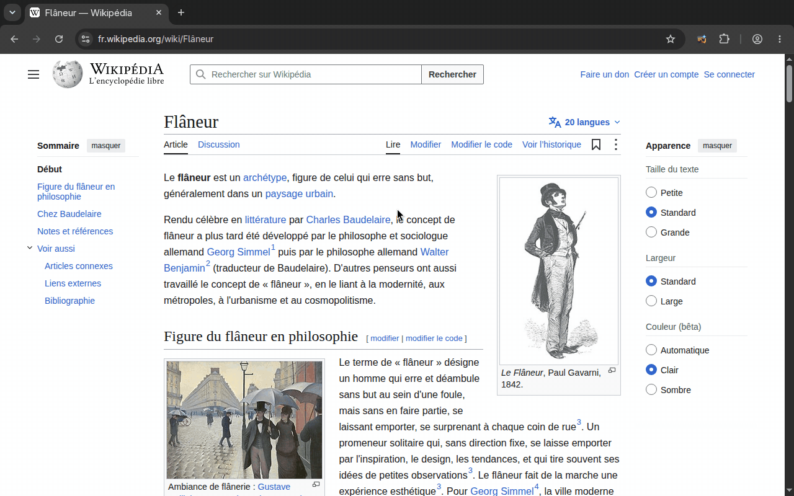
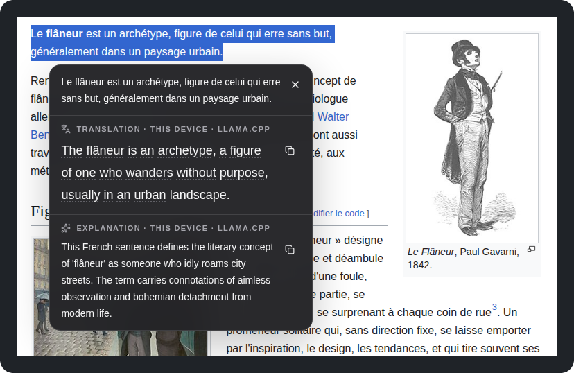
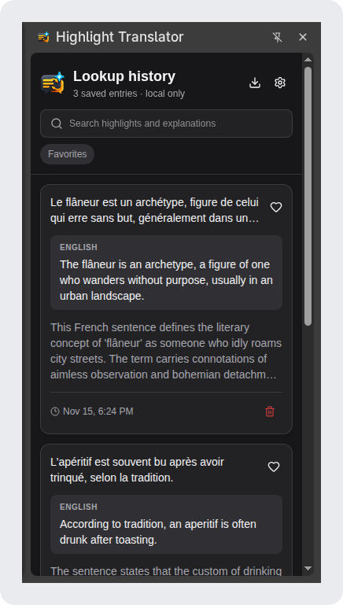
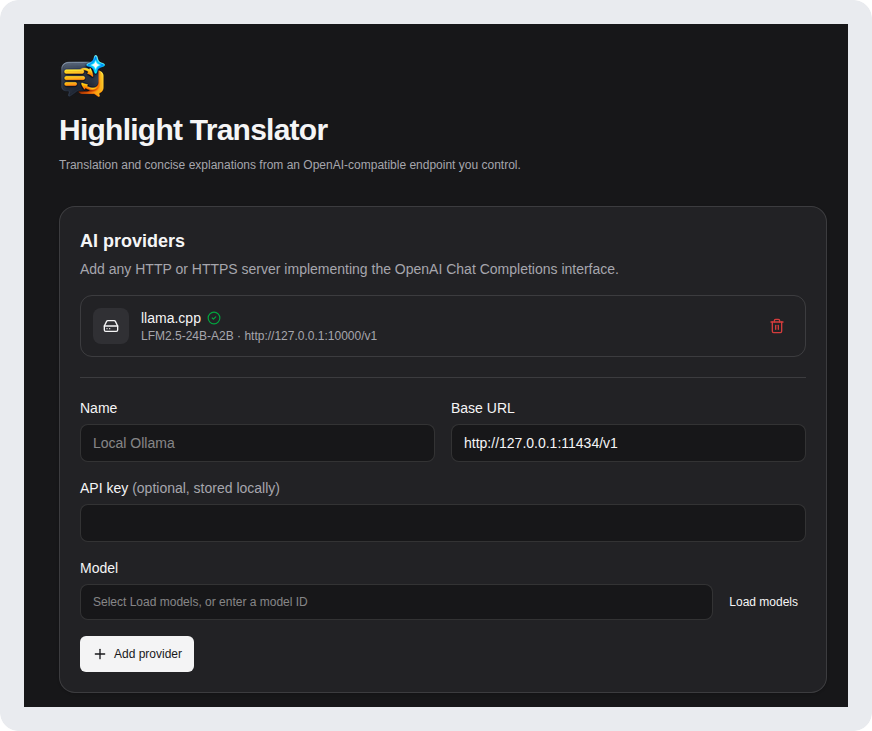

# Highlight Translator

A Chromium extension that translates highlighted text into English and gives a
short contextual explanation using an OpenAI-compatible AI provider. One
structured request produces both results.

<p align="center">
  
</p>
<p align="center">
  <sub>Highlight text, read the translation and explanation in place, and find it again in the side panel.<br>Real-time recording with LFM2.5-24B-A2B on a local llama.cpp server.</sub>
</p>

## Features

- Translation and explanation in one JSON Schema-constrained request
- Ollama, llama.cpp, OpenAI, LAN, and custom OpenAI-compatible endpoints
- Optional streaming with independently rendered translation and explanation
- Shadow DOM lookup card isolated from page styles
- Searchable local history in the Chromium side panel
- Runtime host permissions requested only for endpoints you add
- API keys remain in extension-local storage and never enter the content script

<table>
  <tr>
    <td valign="top"></td>
    <td valign="top"></td>
  </tr>
  <tr>
    <td align="center"><sub>Lookup card, rendered in Shadow DOM over the page</sub></td>
    <td align="center"><sub>Searchable history in the side panel</sub></td>
  </tr>
</table>

## Development

Requirements: Node.js 24+, Corepack, and a Chromium-based browser.

```bash
corepack enable
pnpm install
pnpm test:install
pnpm dev
```

Build and package:

```bash
pnpm build
pnpm zip
```

Load `.output/chrome-mv3-dev` when running `pnpm dev`, and keep that process
running so WXT rebuilds it as files change. For a one-shot rebuild of that same
development directory, run `pnpm build:dev`. If Brave is instead loaded from
`.output/chrome-mv3`, update it with `pnpm build`.

## Testing

```bash
pnpm check
```

`pnpm check` runs type checking, linting, unit tests, and creates the production
extension ZIP. Browser E2E tests remain available as opt-in diagnostics with
`pnpm test:e2e` or `pnpm test:e2e:headed`.

GitHub Actions attaches the ZIP as a downloadable artifact after every
successful CI run. To publish a GitHub Release with that ZIP, push a version
tag such as `v0.1.0`.

## Local model servers

<table>
  <tr>
    <td></td>
  </tr>
  <tr>
    <td align="center"><sub>Add any OpenAI-compatible endpoint, load its models, and pick one</sub></td>
  </tr>
</table>

Ollama:

```bash
OLLAMA_ORIGINS=chrome-extension://* ollama serve
```

Then add `http://127.0.0.1:11434/v1` in the extension settings.

llama.cpp:

```bash
llama-server --model /path/to/model.gguf --host 127.0.0.1 --port 8080
```

Then add `http://127.0.0.1:8080/v1`.

The selected server must implement OpenAI-compatible Chat Completions and
support `response_format` with `json_schema`. For a stable extension ID, replace
the wildcard Ollama origin with the installed extension's exact
`chrome-extension://<id>` origin.

## Privacy model

The highlighted text and a bounded nearby context window are sent only to the
provider selected in settings. That provider may run on the same device, on the
local network, or remotely; the lookup card identifies its location. There is
no automatic fallback to another provider.

History is stored in extension-local IndexedDB without browser sync. Saving
page titles and URLs is disabled by default.
